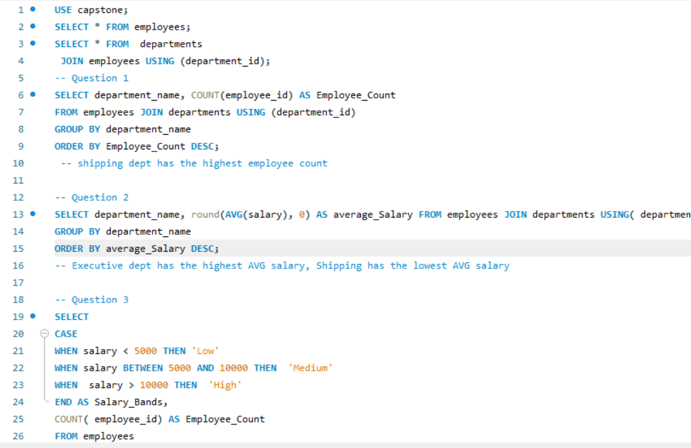
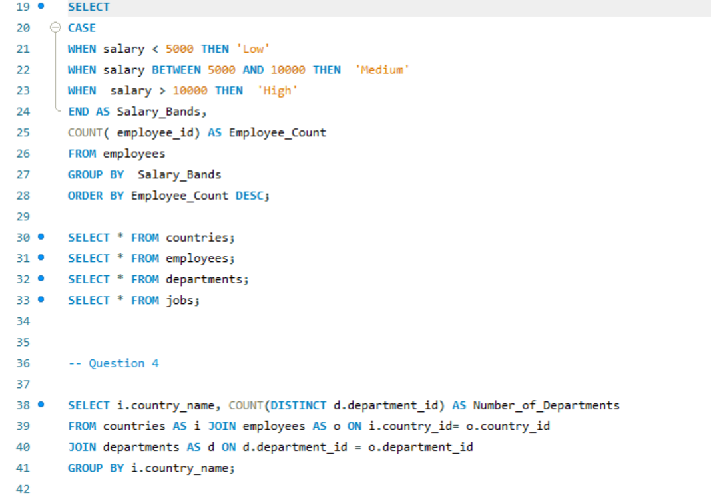

# Orion Data Systems Workforce 

## Executive Summary
   This report analyzes workforce data from Orion Data Systems to provide insights into employee distribution, departmental performance, salary bands, country-level operations, job role performance and workforce structure. It highlights  differences in staffing requirements and compensation across departments.
    
## Business Context
 The HR & Strategy team requires clear, data-driven reporting of their workforce database. The objective is to understand  employee distribution and departmental performance in order to support decision-making.

## Objectives
This report addresses the following key questions:
- How many employees are in each department, and which department has the highest headcount?
- What is the average salary per department, and which department has the highest and lowest average salaries?
- What are the Salary Bands for Employees?
- What are the countries in which Orion Data Systems operates and the number of departments located there?

## Data Overview
The analysis is based on a consolidated dataset consisting of four related tables: countries (3 fields), employees (11 fields), departments (4 fields), and jobs (4 fields).

## Data Preview

## Key Findings
- The Shipping Department recorded the highest employee headcount. 
- The Executive Department had the highest average salary, while the Shipping Department had the lowest average salary.
- Employees were distributed across low, medium, and high salary bands.
- No unassigned or vacant job titles were identified.

## download MySQL file
click the link to access the live Report : 

## [MySQL file](Juliana_Igboin.sql...sql)

## Data Preparation
- Multiple tables were joined to combine employee, department, job, and country data for analysis. 
- Aggregate functions, subqueries, conditional statements, and Common Table Expressions (CTEs) were used to generate workforce insights.

## Detailed Findings & Analysis
### Workforce Distribution
-The Shipping Department recorded the highest employee count among all departments.

### Departmental Salary Comparison
- The Executive Department reported the highest average salary, while the Shipping Department recorded the lowest average salary.

### Salary Band Distribution
- Based on the Employee class system, the Low band had the largest count of employees at 49, while the High band had the least at 15. 43 employees were recorded in the middle band. 

### Country-Level Operations
- Switzerland recorded the highest organization operation with 5  departments, followed by Australia, Italy, Japan and the United states with 4 departments each.
- Several countries recorded 3 departments, while others namely: Nigeria, France, and the United Kingdom recorded only 1, highlighting variations in departmental representation across countries. 

### High-Earning Employees
- Several employees earn salaries above the company-wide average salary with Steven king earning the highest at 24000 and Neena kocchar, Lex De Han following at 17000 each.

### Job Role Analysis
- Multiple job titles recorded average salaries exceeding 12,000 with the President role earning highest at 2400.
- No job roles were identified without employees assigned, indicating that all available job titles within the organization are currently occupied. 

### Salary Cost by Country
- Switzerland records the greatest share of the organization's overall payroll expenditure at 75100.

## Recommendations
- Promote organization operations with more departments across with only single departments.
- Identify key factors contributing to higher employee compensation and use these insights to support talent retention strategies.

## Tools Used
- My SQL: Data cleaning and transformation

## Conclusion
Orion Data Systems Workforce highlights key differences in employee distribution, departmental compensation, salary bands, and country-level operations. The high headcount in Shipping, despite its lower average salary, presents an opportunity to assess workload distribution, productivity, and staffing needs, while salary variations across departments and job roles provide a basis for reviewing compensation competitiveness and employee retention.
Switzerland’s concentration of departments and payroll expenditure also highlights the importance of evaluating country-level resource allocation and identifying opportunities to strengthen operations in countries with limited departmental representation.

